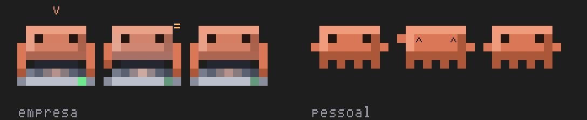
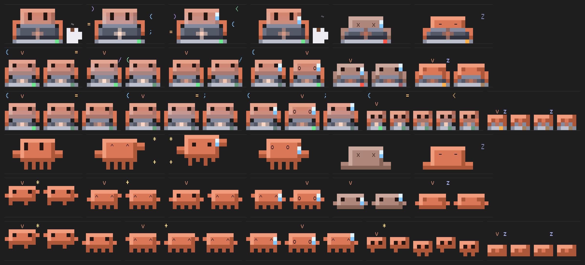
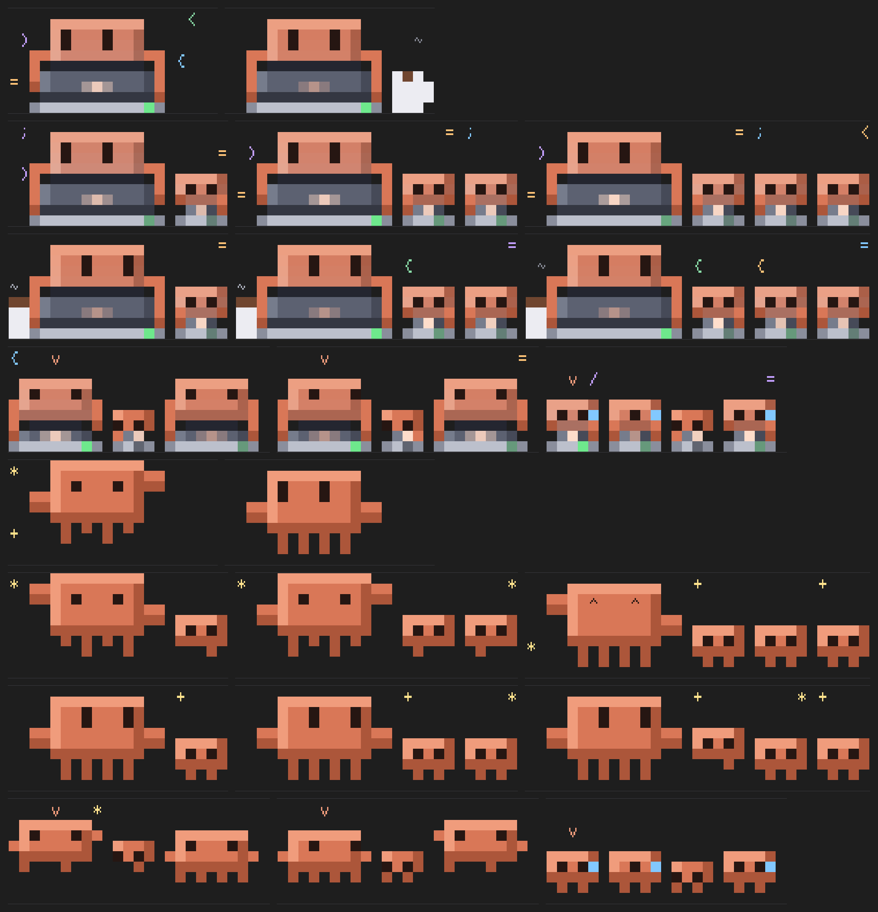

# duo-contas: duas contas do Claude Code, um painel só

Um mod para o Claude Code que junta **duas contas** (por exemplo, a da empresa e a pessoal) num painel embaixo do prompt, com um **Claudinho por sessão** aberta, e que **troca de conta sozinho** quando a primeira chega ao limite, continuando a mesma conversa na outra.

**Baixar:** o zip da versão mais nova fica em [Releases](https://github.com/vinishiosu/duo-contas/releases/latest).



*Três sessões abertas em cada conta. Na empresa, o do meio está codando e os outros esperam no notebook; na pessoal, o do meio dança. A setinha **v** marca a sessão da janela em que você está.*

## O que ele faz

- **Painel embaixo do prompt**, com as duas contas lado a lado:
  - uso da janela de 5 horas e da semana, e o horário em que cada uma renova;
  - o contexto da sessão;
  - até quando vale o cache;
  - a RAM da máquina.
- **Um Claudinho por sessão.** A conta "empresa" aparece como um Claudinho no notebook: codando quando trabalha, na pausa do café quando para. A "pessoal" é o Claudinho clássico, que dança quando trabalha.
  - Com várias sessões, eles encolhem e ficam na ordem das abas do terminal do VS Code. A setinha **v** marca o da janela em que você está.
  - Conta sem nenhuma aba aberta dorme.
  - Subagentes aparecem como **filhotinhos** ao lado.
- **Troca automática:**
  - a conta "empresa" é a que se gasta primeiro;
  - ao chegar a 95%, a sessão passa para a "pessoal" com a conversa inteira, no mesmo terminal, e leva junto as memórias criadas na sessão;
  - quando a empresa tem folga de novo (abaixo de 80%), a sua próxima mensagem volta para ela.
- **Cuidado com trabalho em segundo plano.** Se há algo rodando em segundo plano (um comando, um subagente), a troca espera ele terminar. A partir de 98%, ou se uma resposta morrer no limite, ela troca mesmo assim, para a sessão não ficar congelada até a janela renovar, e avisa a sessão nova do que foi interrompido.
- **Acorda a conta parada.** Se uma conta está sem janela de 5h correndo, ele manda um "oi" invisível (no modelo Haiku, custo mínimo) para a janela começar a contar.





## Requisitos

| Item | Observação |
|---|---|
| Windows 10 ou 11 | Os scripts são em PowerShell (o 5.1, que já vem no Windows, serve). Mac e Linux ainda não. |
| Claude Code recente | Testado na 2.1.296. O mod usa a API de mods do Claude Code (hooks module). |
| Duas contas do Claude | Cada uma numa pasta de configuração própria (veja abaixo). |
| VS Code (opcional) | Para a ordem das abas e o `/trocar-conta` na mesma aba. Sem ele, o resto funciona. |
| Node.js (opcional) | Só para mostrar a RAM no painel. |

## Como as duas contas convivem

O Claude Code guarda login, configurações e conversas numa pasta. A padrão é `~\.claude`, e aqui ela é a conta **pessoal**. A segunda conta, a **empresa**, usa outra pasta, escolhida pela variável `CLAUDE_CONFIG_DIR`. O padrão do mod é `~\.claude-empresa`, e você pode escolher outra na instalação.

> Os nomes "empresa" e "pessoal" são só rótulos. "Empresa" quer dizer a conta que se gasta primeiro; "pessoal", a reserva.

## Instalação

1. **Baixe** o `duo-contas-<versão>.zip` em [Releases](https://github.com/vinishiosu/duo-contas/releases/latest) e descompacte numa pasta qualquer. (Clonar o repositório também serve: ele tem os mesmos arquivos do zip.)
2. **Abra um PowerShell** nessa pasta e rode:

   ```powershell
   powershell -ExecutionPolicy Bypass -File .\instalar.ps1
   ```

   Para outra pasta de conta empresa: `.\instalar.ps1 -PastaEmpresa "$env:USERPROFILE\.claude-trabalho"`.

   O instalador:
   - copia o mod para `~\.duo-contas`;
   - instala o plugin nas duas contas;
   - cria os comandos `claude-duo` e `claude-empresa` no seu perfil do PowerShell;
   - instala a extensão do VS Code, se o comando `code` existir.
3. **Entre na conta empresa uma vez.** Se ela ainda não tem login:

   ```powershell
   $env:CLAUDE_CONFIG_DIR = "$env:USERPROFILE\.claude-empresa"; claude
   ```

   Faça o `/login` com a conta da empresa e saia.
4. **No VS Code**, rode uma vez o comando "Developer: Reload Window", para a extensão começar.
5. **Abra um terminal novo** e comece por:

   ```powershell
   claude-empresa
   ```

   É ele que liga a troca automática: o Claude roda dentro de um laço que, quando o mod pede a troca, reabre a mesma conversa na outra conta.

> Se aparecer "a execução de scripts foi desabilitada neste sistema", rode uma vez `Set-ExecutionPolicy -Scope CurrentUser RemoteSigned` e abra o terminal de novo.

## Uso no dia a dia

| Comando | O que faz |
|---|---|
| `claude-empresa` (ou `claude-duo`) | Abre o Claude com troca automática. Começa pela empresa, ou pela pessoal se a empresa já estiver no limite. Aceita os mesmos argumentos do `claude`, como `--resume <id>`. |
| `claude-duo --conta pessoal` | Começa pela pessoal. |
| `/trocar-conta [mensagem]` | Dentro de uma sessão, passa a conversa para a outra conta agora. No VS Code com a extensão, continua na mesma aba; sem ela, abre uma janela nova do terminal. |
| `/bichinhos abaixo` / `acima` / `oculto` | Muda onde o painel fica. |

Sessões abertas com o `claude` puro também mostram o painel, mas não trocam sozinhas: elas só avisam, e aí vale o `/trocar-conta`.

## Opções

Pelo `/plugin` dentro do Claude Code (duo-contas, configurar), ou no terminal com `claude plugin configure duo-contas@duo-contas-local`. Cada conta guarda as suas.

| Opção | Padrão | O que é |
|---|---|---|
| `limite` | 95 | A partir de quanto (% da janela de 5h ou da semana) a sessão troca de conta. Com algo em segundo plano, espera terminar. |
| `teto` | 98 | Daqui para cima, troca mesmo com algo em segundo plano. |
| `volta` | 80 | Na pessoal, com a empresa abaixo disto, a próxima mensagem volta para a empresa. |
| `automatico` | ligado | Desligado, o mod só avisa e a troca fica no `/trocar-conta`. |
| `acordar` | ligado | Manda o "oi" invisível que faz a janela de 5h começar a contar. |
| `cacheMinutos` | 60 | Quanto o cache dura depois da última resposta (60 nas assinaturas). |

## Atualizar

Baixe a versão nova em [Releases](https://github.com/vinishiosu/duo-contas/releases/latest), descompacte e rode o `instalar.ps1` de novo. A versão anterior vai para `~\.duo-contas\backup`. Depois, em cada sessão aberta, rode `/reload-plugins`.

## Desinstalar

```powershell
powershell -ExecutionPolicy Bypass -File .\desinstalar.ps1            # tira plugin, comandos e extensão
powershell -ExecutionPolicy Bypass -File .\desinstalar.ps1 -ApagarTudo # e apaga ~\.duo-contas
```

## Problemas comuns

- **O painel não aparece:** rode `/reload-plugins`. Se continuar, confira se o plugin está ativo em `/plugin`.
- **A troca não acontece sozinha:** a sessão precisa ter sido aberta pelo `claude-empresa` ou pelo `claude-duo`. Aberta com `claude` puro, o mod só avisa.
- **Os Claudinhos fora da ordem das abas:** o VS Code não avisa as extensões quando você arrasta uma aba, e a ordem que vale é a de abertura. Depois de arrastar, "Developer: Reload Window" deve acertar.
- **A conta empresa aparece sempre "sem janela ativa":** falta o login nela (passo 3 da instalação).

## Como funciona, por dentro

- **`mod/`** é o plugin. O `hooks/register.tsx` desenha o painel e decide a troca; o `hooks/logic.ts` tem as regras; o `hooks/sprites.ts` tem os Claudinhos em pixel art. Ele lê o uso de cada conta das respostas da API e grava em `~\.duo-contas\contas`, para as sessões das duas contas se enxergarem.
- **`mod/bin/claude-duo.ps1`** é o laço que roda o Claude. Quando o mod deixa um pedido de troca, ele:
  1. copia a conversa (e as memórias novas) para a pasta da outra conta;
  2. troca a `CLAUDE_CONFIG_DIR`;
  3. roda `claude --resume` na mesma janela.
- **`vscode/`** traz a extensão `duo-contas-abas`, em `.vsix` e com o código-fonte junto. Ela grava a ordem dos terminais em `~\.duo-contas\abas` e atende o `/trocar-conta` na mesma aba. Roda dentro do VS Code, sem processo novo.
- Nada sai da sua máquina: tudo fica em arquivos locais em `~\.duo-contas`.

## Problemas e ideias

Abra uma [issue](https://github.com/vinishiosu/duo-contas/issues). Feito por [@vinishiosu](https://github.com/vinishiosu).

## Licença

[MIT](LICENSE): pode usar, modificar e redistribuir, mantendo o aviso de copyright. O mod vem como está, sem garantia. Ele não é um produto oficial da Anthropic; o Claudinho é inspirado no mascote do Claude Code, que é da Anthropic, e a licença vale para o código deste repositório.
